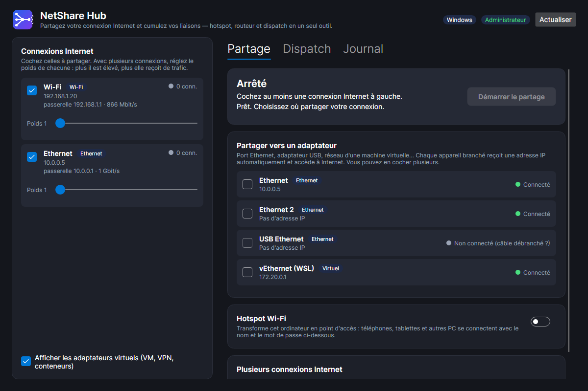
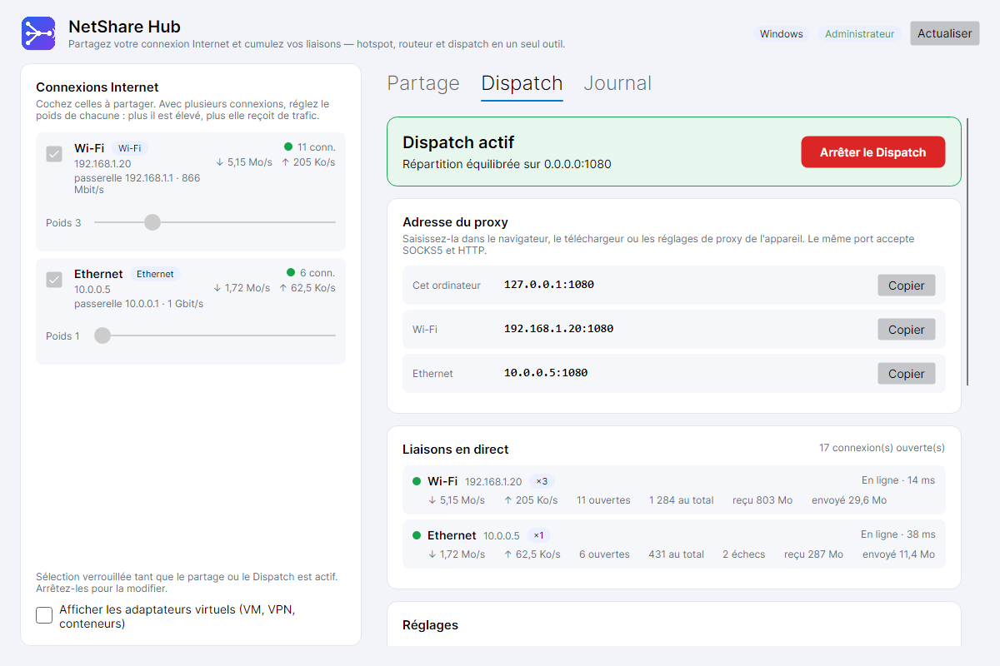

# NetShare Hub

[](https://github.com/aldwgiovanni/NetShareHub/actions/workflows/ci.yml)
[](https://github.com/aldwgiovanni/NetShareHub/releases/latest)
[](LICENSE)


**Partagez votre connexion Internet et cumulez plusieurs liaisons — hotspot Wi-Fi, routeur et agrégation, gratuit et open source.**

Application de bureau **Windows et Linux** qui réunit en un seul outil :

- **Partage** (à la manière de *Connectify Hotspot*) : partagez la connexion Internet de l'ordinateur par un
  **hotspot Wi-Fi**, et/ou vers **un ou plusieurs adaptateurs à la fois** (port Ethernet, adaptateur USB, réseau d'une VM…).
  Chaque appareil branché reçoit automatiquement une adresse IP et accède à Internet.
- **Dispatch** (à la manière de *Connectify Dispatch*) : **cumulez plusieurs connexions** (Wi-Fi + Ethernet + clé 4G…).
  Un proxy SOCKS5/HTTP sur **un port de votre choix** répartit chaque nouvelle connexion entre vos liaisons, surveille leur
  état et bascule automatiquement si l'une tombe.

Les deux fonctions partagent la même liste de connexions : vous cochez vos sources une fois, avec un **poids** par connexion.




## Démarrage en 2 minutes

1. **Téléchargez** le fichier de votre système sur la page des
   [**Releases**](https://github.com/aldwgiovanni/NetShareHub/releases/latest).
   Tout est **autonome** : le runtime .NET est embarqué, rien à installer à côté.

   | Système | Fichier | Installation |
   |---|---|---|
   | Windows 10/11 (64 bits) | `NetShareHub-Setup-<version>-x64.exe` | Double-clic, puis suivez l'assistant |
   | Windows, sans installation | `NetShareHub-<version>-win-x64-portable.zip` | Décompressez, lancez `NetShareHub.exe` |
   | Debian / Ubuntu / Mint | `netsharehub_<version>_amd64.deb` (`arm64` pour Raspberry Pi 64 bits…) | `sudo apt install ./netsharehub_<version>_amd64.deb` |
   | Autres Linux | `netsharehub-<version>-linux-x64.tar.gz` (ou `arm64`) | `tar xzf netsharehub-*.tar.gz && cd netsharehub-* && sudo ./install.sh` |

2. **Lancez** NetShare Hub (menu Démarrer / menu des applications, ou `netsharehub` sous Linux).
3. À gauche, vos connexions Internet sont déjà cochées. Choisissez ensuite :
   - **Cumuler des connexions** → onglet **Dispatch** → *Démarrer le Dispatch* → saisissez l'adresse affichée comme proxy ;
   - **Partager** → onglet **Partage** → cochez un adaptateur et/ou activez le hotspot → *Démarrer le partage*
     (le bouton *Relancer en administrateur* s'affiche si nécessaire).

> **Windows : « Windows a protégé votre ordinateur » (SmartScreen).** L'installeur n'est pas (encore) signé par un certificat
> payant. Cliquez sur *Informations complémentaires* → *Exécuter quand même*. Vous pouvez vérifier l'intégrité du fichier avec
> `SHA256SUMS.txt`, publié avec chaque version, ou compiler vous-même (voir plus bas).
>
> **Linux** : les paquets fonctionnent sur les distributions avec glibc récente (Ubuntu 22.04+, Debian 12+, Fedora 38+…).
> Le hotspot et le partage simple s'appuient sur **NetworkManager** ; le reste (Dispatch, partage par NAT) n'en a pas besoin.

Vérifier une archive téléchargée (optionnel) :

```bash
sha256sum -c SHA256SUMS.txt --ignore-missing          # Linux
Get-FileHash .\NetShareHub-*-x64.exe                  # Windows (PowerShell), à comparer à SHA256SUMS.txt
```

## Utilisation

### Dispatch — cumuler plusieurs connexions (aucun droit administrateur)

1. À gauche, cochez les connexions à cumuler et réglez leur **poids** (une liaison de poids 3 reçoit trois fois plus de connexions qu'une de poids 1).
2. Onglet **Dispatch** → choisissez le port (1080 par défaut) et le mode de répartition → **Démarrer le Dispatch**.
3. Saisissez l'adresse affichée (`127.0.0.1:1080`) comme proxy **SOCKS5** ou **HTTP** dans le navigateur, le gestionnaire
   de téléchargement ou les réglages de proxy de l'appareil. Le même port accepte les deux protocoles.
4. Pour d'autres appareils (téléphone sur votre hotspot…), activez **« Ouvert au réseau local »** et utilisez l'adresse
   de l'ordinateur sur ce réseau. Protégez alors le proxy par un identifiant et un mot de passe.

Test rapide : `curl --socks5-hostname 127.0.0.1:1080 https://example.com`

| Mode | Comportement |
|---|---|
| Répartition équilibrée | Chaque nouvelle connexion va tour à tour vers chaque liaison, proportionnellement aux poids. À privilégier pour cumuler les débits. |
| Moins chargée d'abord | La liaison qui a le moins de connexions ouvertes (rapporté à son poids) prend la suivante. |
| Secours | Une seule liaison est utilisée ; les autres ne servent qu'en cas de panne. |

L'option **« Garder un même site sur la même liaison »** évite que banques, messageries et réseaux sociaux ne coupent la session
quand l'adresse IP change en cours de route.

### Partage — hotspot et routeur (droits administrateur requis)

Lancez l'application en administrateur (le bouton **Relancer en administrateur** le fait ; UAC sous Windows, polkit sous Linux),
cochez la ou les connexions à partager, puis :

- **Partager vers un adaptateur** : cochez un ou plusieurs adaptateurs branchés ;
- **Hotspot Wi-Fi** : activez-le, choisissez le nom, le mot de passe (8 à 63 caractères) et la bande ;
- **Démarrer le partage**.

Fermer l'application, ou **Arrêter le partage**, rétablit la configuration réseau d'origine. Si l'application est tuée en plein
partage, la configuration est restaurée automatiquement au lancement suivant (journal d'annulation persistant).

## Ce qui est disponible selon le système

| Fonction | Windows | Linux |
|---|---|---|
| Dispatch (proxy SOCKS5/HTTP, poids, secours, sondes) | oui | oui |
| Partage vers **un** adaptateur | Partage de connexion Internet (ICS) natif | NetworkManager (`ipv4.method shared`) |
| Partage vers **plusieurs** adaptateurs | NAT et DHCP intégrés — *expérimental* | NetworkManager, ou NAT iptables + DHCP intégré |
| Hotspot Wi-Fi | « Point d'accès mobile » de Windows | NetworkManager (carte Wi-Fi compatible mode AP) |
| Répartition **automatique** du trafic des appareils partagés sur plusieurs sources | non (utiliser le Dispatch) | oui (routage multi-chemins du noyau) |

## Limites à connaître

- **Dispatch = connexion par connexion.** Un téléchargement unique reste sur une seule liaison ; plusieurs onglets, applications
  ou téléchargements en parallèle se répartissent. Un *bonding* paquet par paquet (cumuler deux liaisons sur *un seul* flux)
  exige un serveur relais : ce n'est pas fait ici.
- **UDP non géré** par le proxy (jeux en ligne, appels vidéo, certaines visioconférences). Navigation, applications compatibles
  proxy et téléchargements fonctionnent.
- **Windows** : pas de répartition transparente du trafic des appareils partagés (cela demanderait un pilote noyau). Ils sortent
  par la connexion de poids le plus élevé ; pour cumuler, passez par le proxy Dispatch.
- **Hotspot sous Windows** : il dépend de la carte Wi-Fi et de son pilote (« Point d'accès mobile »). Si le Point d'accès mobile
  est déjà actif dans les Paramètres, désactivez-le d'abord.
- **Hotspot sous Linux** : la carte qui émet le hotspot ne peut pas être celle qui sert de source Internet ; il faut une
  seconde carte Wi-Fi ou une source filaire.
- **NAT Windows** : une seule instance de NAT est autorisée par certaines versions ; WSL, Docker ou Hyper-V peuvent déjà en
  occuper une (le message d'erreur le dit).
- Le DNS est résolu par le proxy via le résolveur du système (pas via la liaison choisie).

## Sécurité

- Le partage modifie la configuration réseau : il exige les droits administrateur / root, jamais demandés pour le Dispatch seul.
- Un proxy **ouvert au réseau local sans mot de passe** peut être utilisé par n'importe quel appareil connecté : activez
  l'authentification dès que le réseau n'est pas de confiance. Le proxy n'écoute que sur `127.0.0.1` par défaut.
- Le mot de passe du hotspot est enregistré dans `settings.json` (profil utilisateur, lisible par le seul propriétaire sous
  Linux). Sous Linux, `nmcli` reçoit ce mot de passe en argument : il est brièvement visible dans la liste des processus.
- Les commandes système sont exécutées **sans interpréteur de shell** (arguments séparés) ; les valeurs insérées dans les
  scripts PowerShell sont systématiquement échappées.

## Dépannage

| Symptôme | Piste |
|---|---|
| « Port DHCP (UDP 67) occupé » | Un autre service DHCP tourne (partage Windows existant, VM, dnsmasq). Arrêtez-le, ou partagez vers un seul adaptateur. |
| Le hotspot est grisé | Voir la note affichée dessous : carte Wi-Fi absente, pilote incompatible, stratégie de groupe, ou pas de connexion Internet active. |
| « Service ICS désactivé » (Windows) | Activer le service « Partage de connexion Internet (ICS) » (`SharedAccess`). |
| Le partage échoue sous Linux sans NetworkManager | Installer `iproute2` et `iptables` ; le hotspot Wi-Fi demande NetworkManager. |
| Windows Defender demande une autorisation | Autorisez NetShare Hub sur le réseau privé quand le proxy est ouvert au réseau local. |
| Journal | Onglet **Journal** ; fichier complet dans `%APPDATA%\NetShareHub\logs` (Windows) ou `~/.config/netsharehub/logs` (Linux). |

## Architecture

Solution .NET 10, interface [Avalonia](https://avaloniaui.net) 12.

```
Src/NetShareHub
├── Domain          Entités, DTOs (_InDto / _OutDto), énumérations, exceptions, value objects (Ipv4Subnet)
├── Application     Contrats (interfaces) et logique pure : SharingPlanner, UplinkBalancer, SubnetAllocator
├── Infrastructure  Moteurs de partage Windows/Linux, serveur DHCP, proxy Dispatch, inventaire réseau, stockage
├── Desktop         Application Avalonia (vues, view models) et racine de composition (extensions Add*)
└── Tests           140 tests : unitaires, intégration (vrais sockets, vrais scripts PowerShell), interface (rendu hors écran)
```

Points de conception :

- Les moteurs de partage **ne modifient jamais le système sans avoir enregistré l'annulation correspondante** dans un journal
  persistant (`UndoJournal`) : un échec à mi-parcours, un plantage ou une coupure de courant n'abandonnent pas une machine dans
  un état réseau modifié.
- Tout passe par `ICommandRunner` : les moteurs sont testés en vérifiant les commandes émises, sans toucher au réseau.
- Le Dispatch force chaque socket sortant sur un adaptateur précis sans pilote : `IP_UNICAST_IF` sous Windows,
  `SO_BINDTODEVICE` sous Linux.

## Questions fréquentes

**Faut-il être administrateur ?** Pas pour le Dispatch. Oui pour le partage (hotspot, routeur), car il modifie la configuration réseau.

**Est-ce que ça double ma vitesse ?** Pour plusieurs téléchargements ou onglets en parallèle, oui : chaque connexion part sur une
liaison différente. Un fichier unique reste sur une seule liaison (voir [Limites](#limites-à-connaître)).

**Mes appareils n'ont pas de réglage de proxy…** Utilisez l'onglet Partage avec un hotspot : sous Linux, le trafic est réparti
automatiquement entre vos connexions. Sous Windows, passez par le proxy sur les appareils qui en acceptent un.

**Que se passe-t-il si je ferme l'application en plein partage ?** Elle arrête le partage et restaure la configuration réseau
d'origine. En cas de plantage, la restauration est faite au lancement suivant.

**Où sont mes réglages ?** `%APPDATA%\NetShareHub` (Windows) ou `~/.config/netsharehub` (Linux).

**Désinstaller** : Windows → *Paramètres › Applications* (ou supprimez le dossier du zip) ; Debian/Ubuntu →
`sudo apt remove netsharehub` ; autre Linux → `sudo ./uninstall.sh` (fourni dans l'archive).

## Contribuer et signaler un problème

Les retours sont bienvenus : [ouvrir un ticket](https://github.com/aldwgiovanni/NetShareHub/issues/new/choose)
(précisez le système, la version et le contenu de l'onglet Journal) ou lire [CONTRIBUTING.md](CONTRIBUTING.md) pour proposer du code.
Particulièrement utiles : des essais du **partage** sur du matériel varié (cartes Wi-Fi, distributions Linux).

## Licence

[MIT](LICENSE) — utilisation, modification et redistribution libres, y compris commerciales.

## Compiler, tester, empaqueter

Prérequis : [SDK .NET 10](https://dotnet.microsoft.com/download) (PowerShell et, pour les paquets Linux depuis Windows, WSL).
Le dépôt s'ouvre tel quel dans Visual Studio 2026, Rider ou VS Code (`NetShareHub.slnx`).

```powershell
git clone https://github.com/aldwgiovanni/NetShareHub.git
cd NetShareHub
dotnet build NetShareHub.slnx
dotnet test Src/NetShareHub/Tests/NetShareHub.Tests.csproj
./packaging/build.ps1                    # win-x64 + linux-x64 + linux-arm64 → dossier dist/
./packaging/build.ps1 -Targets win-x64   # Windows seul
```

- L'installeur Windows `.exe` est généré si [Inno Setup 6](https://jrsoftware.org/isdl.php) est installé ; sinon seul le zip portable l'est.
- Les paquets Linux se construisent aussi directement sous Linux : `packaging/linux/build-linux-packages.sh`.
- `nuget.config` limite les sources à nuget.org (les flux privés de la configuration globale ne sont pas interrogés).
- Les captures de `docs/screenshots` sont produites par les tests d'interface (variable `NSH_SCREENSHOTS` pour choisir le dossier).
